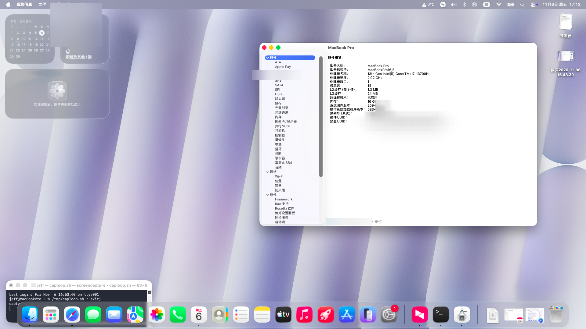
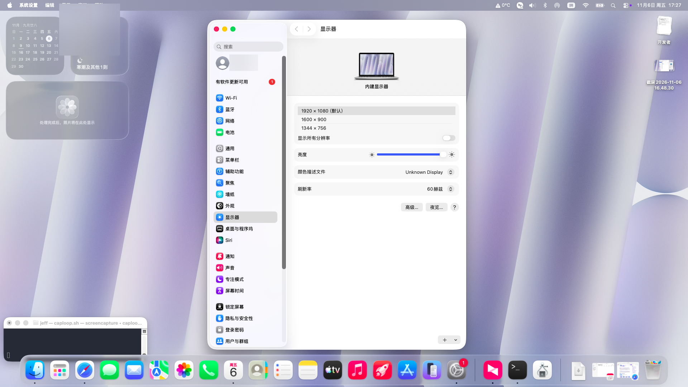
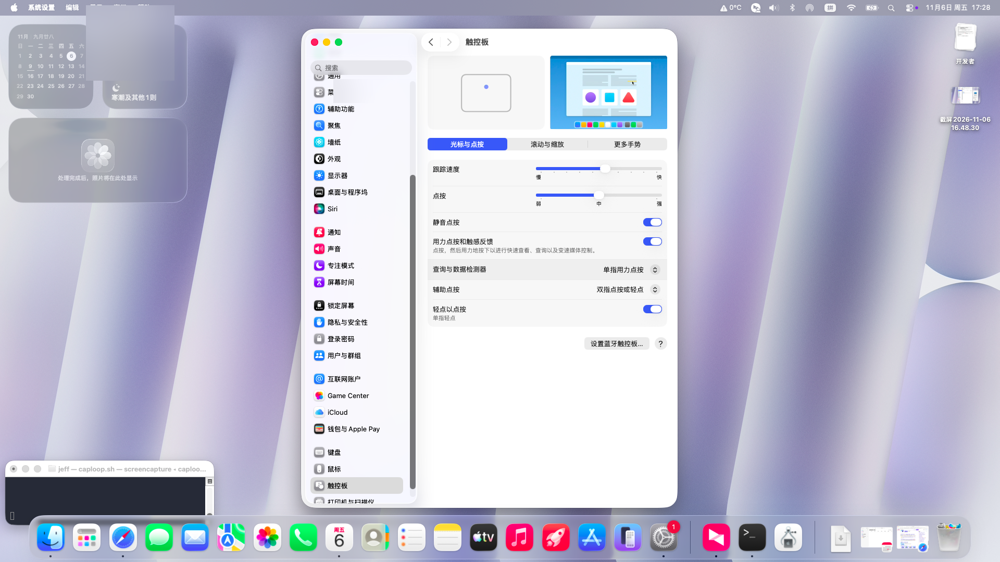
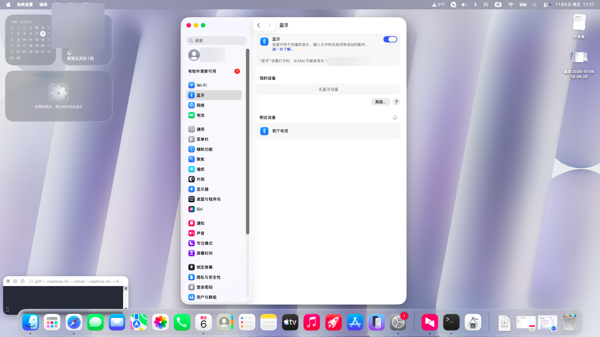
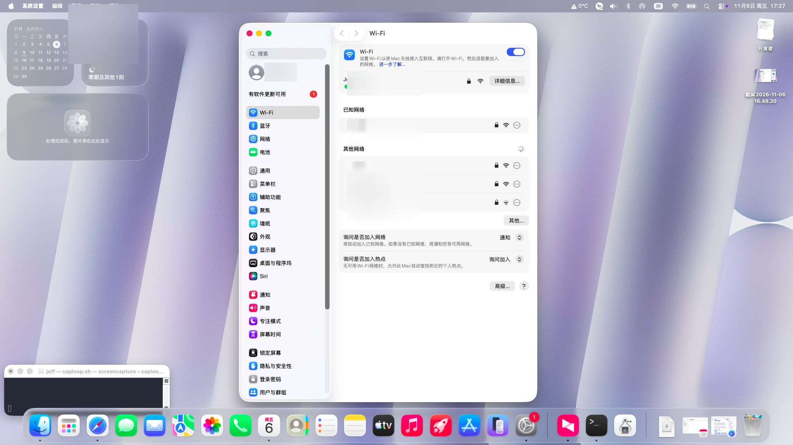
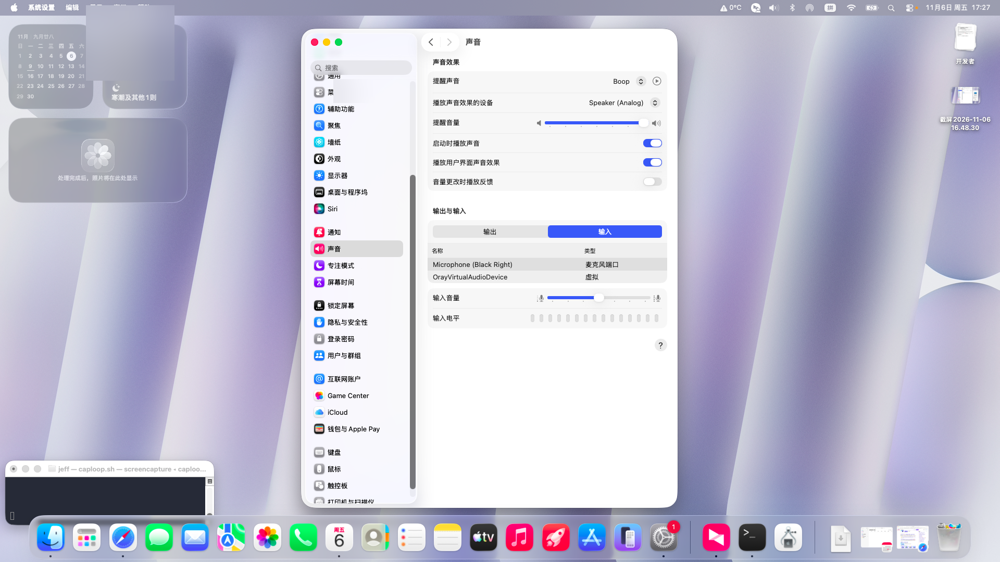
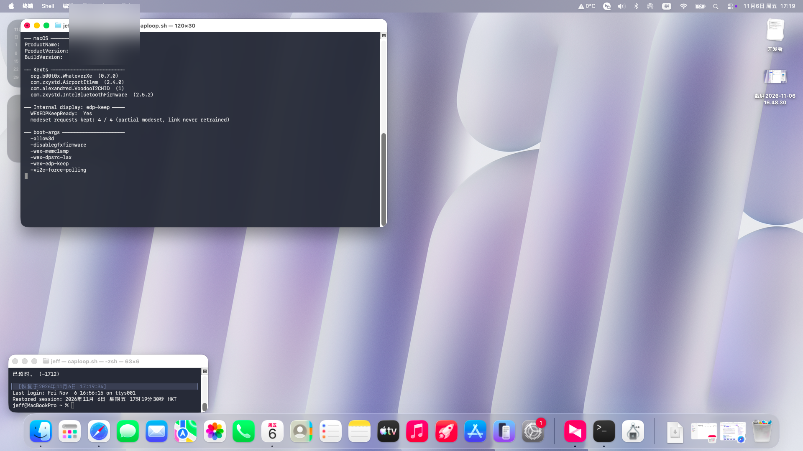

# HP ZBook Power G10 · macOS 26 Tahoe 黑苹果

HP ZBook Power G10（i7-13700H / Raptor Lake-H）在 macOS 26.7.1 上的完整可用配置记录：**每一项硬件当前能不能用、靠什么实现、遇到什么问题、怎么解决的**。

内屏（eDP）、触摸板、Wi-Fi、蓝牙、音频、电池、摄像头、USB 全部可用；睡眠不可用（原因与取舍见下文）。

-black)


---

## 1. 机器配置

| 项目 | 规格 |
|---|---|
| 机型 | HP ZBook Power G10（移动工作站） |
| CPU | Intel Core i7-13700H（6P + 8E，20 线程） |
| 核显 | Intel Iris Xe / UHD Graphics，Device ID `0xA720` |
| 内存 | 16 GB |
| 硬盘 | Samsung MZVL2512HCJQ（512 GB NVMe，PM9A1） |
| 屏幕 | 1920×1080 eDP 内屏（无独显） |
| 系统 | macOS 26.7.1（Build 25G241，Tahoe） |
| 引导 | OpenCore 1.0.9（DBG-109-2026-10-23） |
| SMBIOS | MacBookPro16,2 |

---

## 2. 系统截图

> 截图中的序列号 / UUID / 用户名 / Wi-Fi 名称已做模糊处理。

<details>
<summary><b>点开查看截图</b></summary>

| | |
|---|---|
|  |  |
| *系统信息 · 硬件概览（i7-13700H / 16GB / UHD 1536MB）* | *显示器 · 内屏 1920×1080 60Hz 正常输出* |
|  |  |
| *触控板 · ELAN07BB 经 VoodooI2C 正常识别* | *蓝牙 · Intel AX211 蓝牙可用* |
|  |  |
| *Wi-Fi · AX211 已连接* | *声音 · VoodooHDA 扬声器/耳机* |
|  | |
| *终端验证 · 驱动版本 / edp-keep 4/4 / boot-args* | |

</details>

---

## 3. 硬件支持总表

| 硬件 | 型号 / ID | 状态 | 实现方式 |
|---|---|---|---|
| CPU | i7-13700H | ✅ 20 线程（6P/8E 拓扑修正），单核睿频约 3.7–3.9GHz | `CpuTopologyRebuild` + `SSDT-PLUG-ALT` + `CPUFriend`（见 [§5.6](#56-cpu-睿频被-smbios-借用的频率表)） |
| 核显 | UHD `0xA720` | ✅ Metal 2，VRAM 1536 MB | `WhateverXe` 0.7.0 + `AppleIntelTGLCompat` |
| **内屏** | 1920×1080 eDP | ✅ 点亮（关键：`-wex-edp-keep`） | 见 [§5.1](#51-内屏eDP点亮最大的坑) |
| 触摸板 | ELAN07BB（I2C HID） | ✅ 顺滑（轮询模式） | `VoodooI2C` 2.9.1 + `VoodooI2CHID` + `-vi2c-force-polling` |
| 键盘 | PS/2 | ✅ 含亮度键 | `VoodooPS2Controller` 2.3.8 + `BrightnessKeys` |
| Wi-Fi | Intel Wi-Fi 6E AX211（`8086:51ef`，CNVi） | ✅ 自动连接 | `AirportItlwm` 2.4.0 + 开机守护脚本 |
| 蓝牙 | Intel AX211 BT（USB `8087:0033`） | ✅ 可用 | `IntelBluetoothFirmware` + `IntelBTPatcher` + `BlueToolFixup` |
| 有线网卡 | Intel I219-LM（`8086:51a4`） | ✅ 可用 | `IntelMausiEthernet` 3.0.3 |
| 音频 | 板载（VoodooHDA） | ✅ 扬声器 + 耳机口 | `VoodooHDA` 3.0.2（Tahoe 无 AppleHDA，AppleALC 不可用） |
| 电池 | 智能电池 | ✅ 电量/循环次数正常 | `SMCBatteryManager` + `ECEnabler` |
| 存储 | NVMe | ⚠️ 可用，偶发写超时死机（硬件问题） | `NVMeFix` 1.1.4 |
| 摄像头 | HP HD Camera（UVC `1480:2822`） | ✅ 原生免驱 | macOS 原生 UVC |
| USB | — | ✅ 端口定制正常 | `USBToolBox` + `UTBDefault` + `SSDT-USBX` |
| 读卡器 | Card Reader | ⚠️ 未验证/未驱动 | — |
| 指纹识别 | — | ❌ 无解（macOS 不支持第三方指纹） | — |
| **睡眠** | — | ❌ 主动禁用 | 见 [§6](#6-已知限制) |

---

## 4. 项目结构

```
.
├── README.md
├── docs/
│   ├── internal-display-fix.md    # 内屏修复的技术细节（AUX 超时 / DPCD / edp-keep）
│   ├── build-from-source.md       # 从源码构建 edp-keep 版驱动（含补丁与部署流程）
│   ├── cpu-turbo.md               # CPU 睿频：频率表借用、CPUFriend 与实测数据
│   └── images/                    # 系统截图
├── efi/
│   └── OC/
│       ├── config.plist           # 已清除序列号的公开版本
│       └── ACPI/                  # 10 个 SSDT
└── scripts/
    ├── wifi-fix.sh                # 开机 Wi-Fi 自愈脚本
    └── com.jeff.wififix.plist     # 对应 LaunchDaemon
```

> 本仓库**不包含**第三方 kext 二进制文件，只列版本与来源（见 [§7](#7-kext-清单)）。请从各项目官方 Release 下载。

---

## 5. 关键实现说明

### 5.1 内屏（eDP）点亮：最大的坑

**症状**：开机跑码阶段内屏正常显示，macOS 驱动接管瞬间变黑；手电筒照屏幕**有背光、无画面**，外接显示器正常。

**诊断结论**（完整证据链见 [docs/internal-display-fix.md](docs/internal-display-fix.md)）：

- 面板本身健康：DPCD 可读，AUX 背光模式寄存器已锁存，亮度值正常
- 内核日志：`FB0: Hardware mode set failed, err = 0xe00002d8`（AUX 重试耗尽）
- 即：**驱动重新训练 eDP 链路时 AUX 事务全部超时**，而固件在开机时已经训练好了这条链路

**解决方案**：启用 `-wex-edp-keep`（来自 WhateverXe 上游 [issue #43](https://github.com/b00t0x/WhateverXe/issues/43) 的社区方案，nickk19 的 fork）。

```diff
# boot-args
- amfi_get_out_of_my_way=1 msgbuf=1048576 -v
+ amfi_get_out_of_my_way=1 msgbuf=1048576 -v -wex-edp-keep
```

原理：驱动检测到固件已训练好的链路时，回答 `Partial modeset`，**断开重训改为复用现成链路**，链路不断、画面不掉。

**验证**：

```bash
ioreg -l | grep WEXEDPKeep
# "WEXEDPKeep" = <01000000040000000400000000...>
#  version=1  call=4  kept=4（4 次 modeset 全部被拦为 Partial）
```

日志中不再出现 `Hardware mode set failed`，内屏点亮且 Metal 加速正常。

### 5.2 触摸板：突停突跳

**症状**：光标移动时突然卡住，然后一次跳到很远处。

- 触摸板型号 ELAN07BB，走 I2C HID（`VoodooI2C`），默认使用 GPIO 中断（`gpioPin 323`）
- HP 机型的 GPIO 中断不可靠：中断丢失 → 事件在驱动里积压 → 恢复时一次性涌出
- 日志里没有任何 I2C 错误，因为链路本身没坏，坏的是“通知机制”

**解决**：强制轮询模式

```diff
- amfi_get_out_of_my_way=1 msgbuf=1048576 -v -wex-edp-keep
+ amfi_get_out_of_my_way=1 msgbuf=1048576 -v -wex-edp-keep -vi2c-force-polling
```

代价是极小的 CPU 占用（8 ms 报告周期），换来完全稳定的手感。

### 5.3 Wi-Fi：重启后必须手动开关

**症状**：每次重启后 Wi-Fi 图标是灰的，手动关一下再开就正常。

**根因**：`airportd` 在 `itlwm` 接口就绪**之前**启动，初始化失败后不再重试；手动开关等于变相重启 `airportd`。

**解决**：开机守护，检测接口状态，必要时重启 `airportd`（见 `scripts/`）。

```bash
sudo cp scripts/wifi-fix.sh /usr/local/bin/wifi-fix.sh
sudo chmod 755 /usr/local/bin/wifi-fix.sh
sudo cp scripts/com.jeff.wififix.plist /Library/LaunchDaemons/
sudo chown root:wheel /Library/LaunchDaemons/com.jeff.wififix.plist
sudo launchctl bootstrap system /Library/LaunchDaemons/com.jeff.wififix.plist
```

### 5.4 音频：VoodooHDA 而非 AppleALC

macOS Tahoe 移除了 `AppleHDA.kext`，`AppleALC` 无法直接工作，改用 `VoodooHDA`。
安装后需在「系统设置 → 声音 → 输出」选择 **Speaker (Analog)**。

### 5.5 蓝牙

Intel AX211 的蓝牙走 USB，需要三个 kext 配合：

| Kext | 作用 |
|---|---|
| `IntelBluetoothFirmware` 2.5.2 | 上传 Intel 固件 |
| `IntelBTPatcher` 2.5.2 | 修补 Intel 蓝牙协议栈 |
| `BlueToolFixup` 2.7.3 | 修复 macOS 12+ 蓝牙工具链 |

### 5.6 CPU 睿频：被 SMBIOS 借用的频率表

**症状**：「关于本机」显示 2.92GHz，满载实测封顶 **3.8GHz**（i7-13700H 规格单核 5.0GHz）。

**根因**：SMBIOS 用 `MacBookPro16,2`，macOS 于是加载该机型资源表
`Mac-5F9802EFE386AA28.plist`——它属于 **Ice Lake i7-1068NG7**（规格恰好全核 3.8 / 单核 4.1GHz），
XCPM 的 `hard_plimit_max_100mhz_ratio` 被压在 **38**（3.8GHz）。黑苹果上 CPU 未被真正识别，
macOS 只能照抄别人的频率表。

**解决**：`CPUFriend` + 定制 `CPUFriendDataProvider`，把频率表换成规格最接近的
`MacBookPro16,1`（i9-9980HK，P 核 2.4GHz 基频 / 5.0GHz 睿频）的版本——新增 4300/4600/5000 三档：

```bash
# 1. CPUFriend 官方 Tools 里转换资源表
sh Tools/ResourceConverter.sh --kext Mac-AA95B1DDAB278B95.plist   # 产出 CPUFriendDataProvider.kext
# 2. 两个 kext 进 EFI/OC/Kexts，config 的 Kernel → Add 里排在 Lilu 之后
# 3. 关键：macOS 26 属于 CPUFriend 未声明支持的版本，必须加 -cpufbeta
```

> ⚠️ **最容易踩的坑**：不加 `-cpufbeta` 时 RELEASE 版 CPUFriend **静默不加载数据**，
> 表现是 kext 已在 `kextstat` 里、但频率表毫无变化，极难察觉。判定方法：
> ```bash
> ioreg -l -n X86PlatformPlugin | grep -o '"Frequencies"={[^}]*}'
> # 生效前：{"4100"=1,"3800"=1}      生效后：{"4300"=1,"4600"=2,"5000"=3,"4100"=0}
> sysctl machdep.xcpm.hard_plimit_max_100mhz_ratio   # 38 → 50（=5.0GHz）
> ```

**效果与残留**：macOS 侧上限已开到 5.0GHz（硬限制 ratio 50、AC 供电、无热警告、封装功耗仅 13W），
但实测**持续**频率仍在 ~3.7–3.9GHz（自写 AVX2 FMA 基准 ≈111 GFLOPS 交叉验证，非显示误差）。
推断瓶颈在更底层——`Cpuid1Data` 把 CPU 伪装成 `0x000A0655`（Comet Lake）后，HWP/EPP 层
仍按伪装的机型调频。深调（DEBUG 版 CPUFriend + EPP 注入 / 换仿冒 ID）风险高、收益不确定，
本项目保持现状。详细测量过程见 [docs/cpu-turbo.md](docs/cpu-turbo.md)。

---

## 6. 已知限制

| 限制 | 说明 | 规避 |
|---|---|---|
| **睡眠 / 关屏 / 切换分辨率** | 会触发完整 modeset → 内屏黑到下次重启 | 电源设置里关闭睡眠；不要手动关屏或改分辨率 |
| NVMe 偶发死机 | Samsung PM991a/PM9A1 写超时（Windows 下也有报告），非 macOS 问题 | 减少强制断电；重要数据勤备份 |
| CPU 持续频率 | 睿频上限已开到 5.0GHz，但实测持续约 3.7–3.9GHz（伪装 CPUID 导致） | 无（见 [§5.6](#56-cpu-睿频被-smbios-借用的频率表)） |
| 读卡器 | 未验证 | 用 USB 读卡器 |
| 指纹 | macOS 无第三方指纹驱动 | — |
| 系统升级 | 大版本升级可能破坏驱动栈 | 升级前备份 EFI |

---

## 7. Kext 清单

| Kext | 版本 | 来源 |
|---|---|---|
| Lilu | 1.7.3 | [acidanthera/Lilu](https://github.com/acidanthera/Lilu) |
| WhateverXe | 0.7.0 | [b00t0x/WhateverXe](https://github.com/b00t0x/WhateverXe) |
| AppleIntelTGLCompat | 0.7.0 | 同上（PlugIn） |
| VirtualSMC / SMCProcessor / SMCSuperIO / SMCBatteryManager / SMCLightSensor | 1.3.9 | [acidanthera/VirtualSMC](https://github.com/acidanthera/VirtualSMC) |
| CpuTopologyRebuild | 2.0.2 | [b00t0x/CpuTopologyRebuild](https://github.com/b00t0x/CpuTopologyRebuild) |
| CPUFriend / CPUFriendDataProvider | 1.2.9 | [acidanthera/CPUFriend](https://github.com/acidanthera/CPUFriend)（自制 DataProvider） |
| AMFIPass | 1.4.1 | [dhinakg/AMFIPass](https://github.com/dhinakg/AMFIPass) |
| RestrictEvents | 1.1.7 | [acidanthera/RestrictEvents](https://github.com/acidanthera/RestrictEvents) |
| NVMeFix | 1.1.4 | [acidanthera/NVMeFix](https://github.com/acidanthera/NVMeFix) |
| ECEnabler | 1.0.6 | [1Revenger1/ECEnabler](https://github.com/1Revenger1/ECEnabler) |
| VoodooPS2Controller | 2.3.8 | [acidanthera/VoodooPS2](https://github.com/acidanthera/VoodooPS2) |
| VoodooI2C / VoodooI2CHID / VoodooGPIO / VoodooI2CServices | 2.9.1 | [VoodooI2C/VoodooI2C](https://github.com/VoodooI2C/VoodooI2C) |
| VoodooInput | 1.1.7 | [kishorprins/VoodooInput](https://github.com/kishorprins/VoodooInput) |
| BrightnessKeys | 1.0.4 | [acidanthera/BrightnessKeys](https://github.com/acidanthera/BrightnessKeys) |
| AirportItlwm | 2.4.0 | [OpenIntelWireless/itlwm](https://github.com/OpenIntelWireless/itlwm) |
| IntelBluetoothFirmware / IntelBTPatcher | 2.5.2 | [OpenIntelWireless/IntelBluetoothFirmware](https://github.com/OpenIntelWireless/IntelBluetoothFirmware) |
| BlueToolFixup | 2.7.3 | [acidanthera/BrcmPatchRAM](https://github.com/acidanthera/BrcmPatchRAM) |
| IntelMausiEthernet | 3.0.3 | [Mieze/IntelMausiEthernet](https://github.com/Mieze/IntelMausiEthernet) |
| VoodooHDA | 3.0.2 | [chris1111/VoodooHDA-Tahoe](https://github.com/chris1111) |
| USBToolBox / UTBDefault | 1.2.0 | [USBToolBox](https://github.com/USBToolBox/kext) |

## 8. SSDT 清单

| SSDT | 作用 |
|---|---|
| `SSDT-PLUG-ALT` | CPU 电源管理（`plugin-type`） |
| `SSDT-EC` | 假嵌入式控制器，避免与真 EC 冲突 |
| `SSDT-SBUS` | SBUS / SMBus 补全 |
| `SSDT-MCHC` | 内存控制器设备节点 |
| `SSDT-PNLF` | 背光控制设备（配合 WhateverXe 亮度） |
| `SSDT-GPI0` | GPIO 控制器（触摸板中断/轮询） |
| `SSDT-XOSI` | 操作系统判断兼容 |
| `SSDT-RTCAWAC` | RTC 与 AWAC 时钟 |
| `SSDT-USBX` | USB 供电属性 |
| `SSDT-USB-Reset` | USB 端口复位 |

---

## 9. boot-args 逐项说明

| 参数 | 作用 |
|---|---|
| `-v` | 详细模式（保留，便于排障） |
| `msgbuf=1048576` | 扩大内核日志缓冲（1 MB） |
| `amfi_get_out_of_my_way=1` | AMFI 宽松模式（AMFIPass 需要） |
| `IGLogLevel=3` | 核显驱动日志等级 |
| `-ngreentglwithgfx` / `-allow3d` / `-disablegfxfirmware` | 核显加速与传统开关 |
| `ngreen-dmc=adlp` / `-ngreenv189` | DMC 固件与版本伪装 |
| `-ngreenkeepefi` / `-ngreenxefix` / `-ngreenfixbootmode` | 早期引导修补 |
| `-wex-memclamp` / `-wex-dpsrc-lax` / `-igfxdvmt` | 显存与 DP 源宽松匹配 |
| **`-wex-edp-keep`** | **复用固件训练好的 eDP 链路（内屏点亮关键）** |
| **`-vi2c-force-polling`** | **触摸板强制轮询（解决突停突跳）** |
| `-cpufbeta` | 让 CPUFriend 在未声明支持的 macOS 版本上生效（**必需**，见 §5.6） |

---

## 10. 使用说明

1. **不要直接使用仓库里的 `config.plist` 启动**：其中的序列号已替换为占位符
   （`REPLACE-WITH-YOUR-SERIAL` / `REPLACE-WITH-YOUR-MLB`），必须用
   [GenSMBIOS](https://github.com/corpnewt/GenSMBIOS) 生成自己的 `MacBookPro16,2` 三码
2. 把 `efi/` 下的内容放入 EFI 分区（`EFI/OC/`），kext 按 §7 的版本自行下载放入 `EFI/OC/Kexts/`
3. 安装 `scripts/wifi-fix.sh` 守护（见 §5.3）
4. 首次启动建议保留 `-v`，出问题看 `log show --predicate 'process == "kernel"'`
5. 内屏修复的 edp-keep 版 WhateverXe 需自行编译，见
   [docs/build-from-source.md](docs/build-from-source.md)

> ⚠️ 本仓库仅为个人机器配置记录，不构成安装指导。黑苹果有风险，操作前请备份。

---

## 11. 致谢

- [WhateverXe](https://github.com/b00t0x/WhateverXe) —— Raptor Lake 核显驱动
- [nickk19](https://github.com/nickk19/WhateverXe) —— `-wex-edp-keep` 补丁
- [OpenCore](https://github.com/acidanthera/OpenCorePkg) / [Lilu](https://github.com/acidanthera/Lilu) / [VirtualSMC](https://github.com/acidanthera/VirtualSMC)
- [VoodooI2C](https://github.com/VoodooI2C/VoodooI2C) —— 触摸板
- [OpenIntelWireless](https://github.com/OpenIntelWireless) —— Wi-Fi / 蓝牙
- [chris1111](https://github.com/chris1111) —— VoodooHDA Tahoe 安装器

## License

本仓库的文档与脚本采用 MIT 协议；各第三方 kext 遵循其各自许可证。
